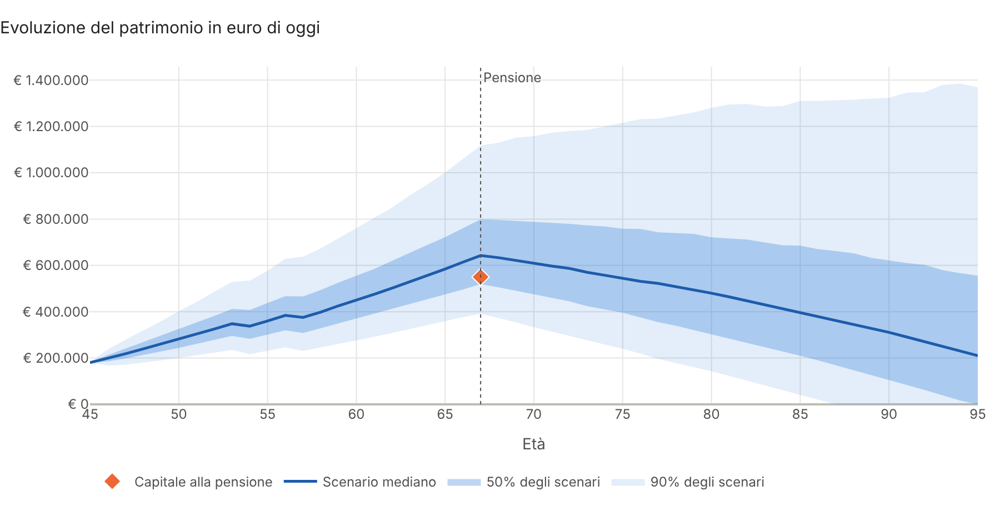
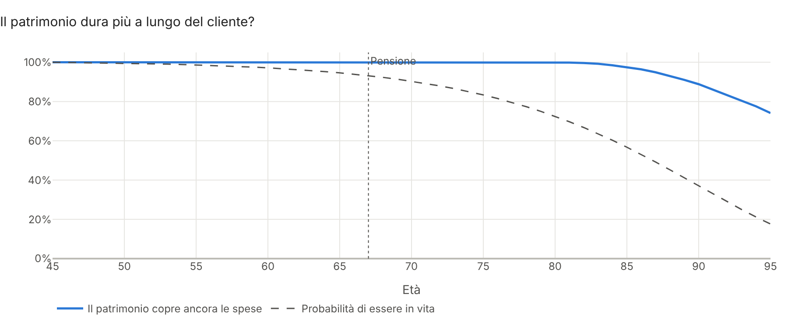
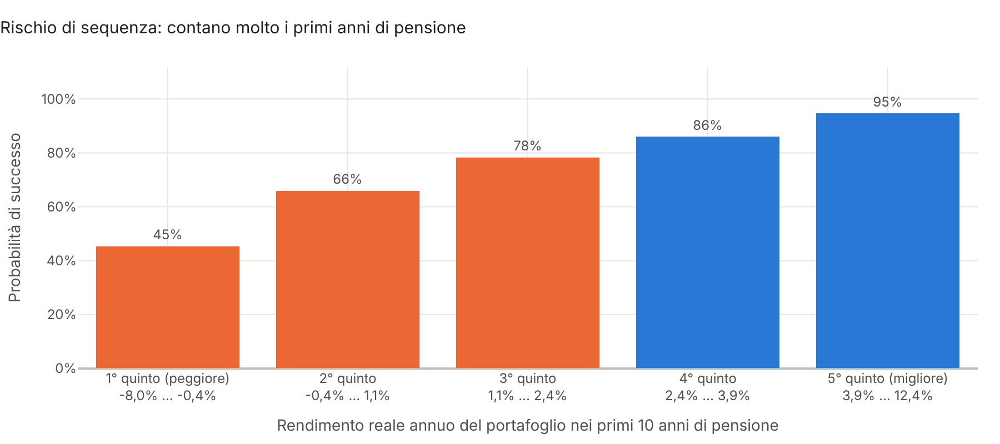
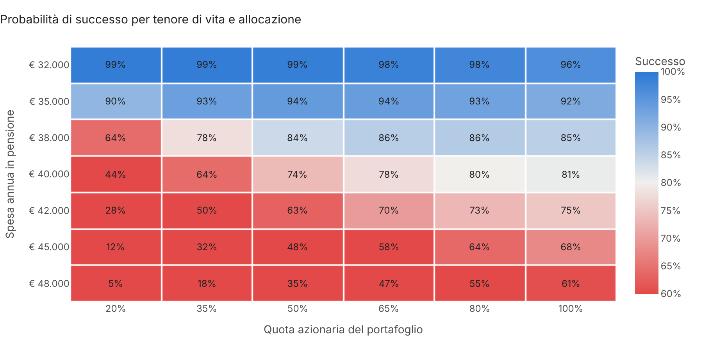

# Wealth Planner Monte Carlo

**Pianificazione patrimoniale con simulazione Monte Carlo, in Python.**

Dato il patrimonio di un cliente, quanto risparmia, quando vuole andare in pensione e quanto vuole spendere, il
progetto simula migliaia di scenari di mercato e di inflazione e risponde alle domande che contano in una
consulenza: **con quale probabilità raggiungo il mio obiettivo? Il patrimonio basta per tutta la pensione? Quanto
posso spendere ogni anno senza rischiare di restare senza risorse?** Il risultato è un **report HTML interattivo
pronto da consegnare al cliente**.



## Cosa fa

| Area | Contenuto |
|---|---|
| **Mercati** | Rendimenti lognormali correlati per azioni, obbligazioni e liquidità (Cholesky), anni turbolenti a volatilità doppia per riprodurre le code grasse |
| **Inflazione** | Processo autoregressivo AR(1): gli anni di inflazione alta tendono a susseguirsi; tutti gli importi sono in euro di oggi |
| **Piano** | Versamenti crescenti fino alla pensione, spesa in pensione, pensione pubblica da un'età a scelta, spese straordinarie (università, casa) |
| **Portafoglio** | Allocazione costante o percorso *life-cycle* verso la pensione, ribilanciamento annuo, costi, imposta di bollo, imposta sulle plusvalenze col costo medio |
| **Prelievi** | Importo fisso indicizzato, percentuale del patrimonio, guardrail (taglio del 10% negli anni difficili, ripristino quando i mercati recuperano) |
| **Indicatori** | Probabilità di successo e di obiettivo, percentili del patrimonio per età, età di esaurimento, rischio di longevità (mortalità di Gompertz), rischio di sequenza |
| **Leve** | Spesa sostenibile e versamento necessario a una probabilità data (metodo di Brent), griglia spesa × quota azionaria, effetto di singole modifiche al piano |
| **Report** | HTML in italiano con grafici interattivi Plotly, tabelle per età, esito in linguaggio semplice |

La simulazione è interamente vettoriale con `numpy` (5.000 scenari su 50 anni in circa 0,2 secondi), le ricerche
dei valori sostenibili usano `scipy`, le tabelle `pandas`, i grafici `plotly`. Tutti i confronti usano gli
**stessi scenari di mercato**, così le differenze dipendono solo dalle scelte del piano e non dal caso.

## Avvio rapido

```bash
git clone https://github.com/Torraf-MI/wealth-planner-montecarlo.git
cd wealth-planner-montecarlo
pip install -e ".[png]"

# Report sull'esempio dimostrativo (famiglia che accumula per la pensione)
wealth-planner --demo --cliente "Mario Rossi"

# Report da un file di ipotesi, autonomo anche senza connessione
wealth-planner --config examples/pensionato_decumulo.toml --cliente "Ing. Bianchi" --offline

# Varianti al volo: altra spesa, pensione più tardi, prelievi con guardrail, 40% di azioni
wealth-planner --demo --spesa 36000 --eta-pensione 69 --strategia guardrail --azioni 0.4 --grafici output/img
```

Il report viene salvato in `output/report.html`. Due esempi già generati:
[famiglia in accumulo](docs/report_esempio.html) (piano da rafforzare) e
[uscita anticipata dal lavoro](docs/report_decumulo.html) (piano solido grazie ai guardrail).

Le ipotesi si scrivono in un file TOML leggibile anche da chi non programma:

```toml
nome = "Famiglia Rossi, piano pensione"

[cliente]
eta = 45
eta_pensione = 67

[flussi]
patrimonio_iniziale = 180000
versamento_annuo = 14000
spesa_annua = 40000          # tenore di vita in pensione, pensione pubblica compresa
pensione_pubblica = 21000

[portafoglio]
pesi = { azioni = 0.70, obbligazioni = 0.25, liquidita = 0.05 }
pesi_pensione = { azioni = 0.45, obbligazioni = 0.45, liquidita = 0.10 }

[obiettivo]
importo = 550000
eta = 67

[[uscite]]
descrizione = "Università del primo figlio"
eta = 53
importo = 30000
```

Le ipotesi di mercato hanno valori predefiniti e si possono cambiare classe per classe (`[mercato.asset.azioni]`).

## Uso come libreria

```python
from wealth_planner import esempio_rossi, genera, prelievo_sostenibile, probabilita_successo, simula
from wealth_planner.analisi import confronta_strategie, leve, percentili

piano = esempio_rossi()
scenari = genera(piano.mercato, piano.anni, n=5_000, seed=42)
r = simula(piano, scenari)

print(probabilita_successo(r))                   # patrimonio sufficiente fino a 95 anni
print(percentili(r).loc[[55, 67, 80, 95]])       # ventaglio del patrimonio in euro di oggi
print(prelievo_sostenibile(piano, 0.90, scenari))  # spesa annua con 9 probabilità su 10

# Cosa cambia andando in pensione a 69 anni o con il 40% di azioni?
print(probabilita_successo(simula(piano.con(cliente__eta_pensione=69), scenari)))
print(probabilita_successo(simula(piano.con_quota_azionaria(0.4), scenari)))

print(confronta_strategie(piano, scenari))       # prelievo fisso, percentuale, guardrail
print(leve(piano, scenari))                      # effetto di singole modifiche al piano
```

Esempio completo in [`examples/esempio.py`](examples/esempio.py) e percorso guidato nel notebook
[`notebooks/demo.ipynb`](notebooks/demo.ipynb).

## Risultati sull'esempio dimostrativo

La famiglia Rossi ha 45 anni, 180.000 € investiti e risparmia 14.000 € l'anno. In pensione a 67 anni vuole
spendere 40.000 € l'anno, di cui 21.000 coperti dalla pensione pubblica, e punta ad avere 550.000 € alla pensione.
Deve anche pagare l'università a due figli. Importi in euro di oggi, 5.000 scenari.

| Indicatore | Valore |
|---|---|
| Probabilità di avere 550.000 € a 67 anni | 69% |
| Patrimonio mediano a 67 anni | € 642.000 |
| **Probabilità che il patrimonio basti fino a 95 anni** | **74%** |
| Rischio di restare senza risorse mentre si è in vita | 10% |
| Spesa sostenibile con 9 probabilità su 10 | € 36.500 l'anno |
| Versamento necessario per l'obiettivo in 8 casi su 10 | € 16.100 l'anno |

Il piano è fattibile ma non ancora solido. Il rischio che conta davvero è più basso della probabilità di
esaurimento: in molti scenari sfavorevoli il patrimonio finisce a un'età che il cliente ha poche probabilità
di raggiungere.



Conta molto **quando** arrivano gli anni cattivi: se i primi dieci anni di pensione sono i peggiori, il piano
riesce in meno della metà dei casi; se sono i migliori, in 19 casi su 20.



Oltre una certa soglia di spesa, aumentare le azioni non compensa: la leva principale è il tenore di vita. Una
spesa flessibile con i **guardrail** porta il successo dal 74% al 93% con una spesa media di circa 37.000 €.



| Modifica al piano | Successo | Obiettivo |
|---|---|---|
| Piano attuale | 74% | 69% |
| Spesa in pensione −10% | 91% | 69% |
| Versamenti +25% | 88% | 86% |
| Pensione 2 anni più tardi | 87% | 69% |
| Azioni +20 punti, senza life-cycle | 80% | 73% |
| Prelievi con guardrail | 93% | 69% |

## Metodologia in breve

- **Rendimenti**: per ogni classe di attività, rendimento annuo lognormale con media e volatilità indicate; la
  correlazione è introdotta con la fattorizzazione di Cholesky. Nella distribuzione a regimi il 10% degli anni è
  turbolento, con volatilità doppia per tutte le attività: la volatilità degli anni normali è ridotta in modo che
  quella complessiva non cambi e la media di ogni regime è corretta in modo che il rendimento atteso resti quello
  indicato. Ne risultano perdite estreme più frequenti che con la curva normale.
- **Inflazione**: π<sub>t</sub> = μ + φ(π<sub>t−1</sub> − μ) + ε<sub>t</sub>, con partenza dalla distribuzione
  stazionaria. Versamenti, spese e pensione pubblica sono rivalutati con l'inflazione simulata.
- **Anno tipo**: versamento, prelievo, rendimento del portafoglio ribilanciato al netto dei costi, imposta di bollo
  dello 0,2% sul valore. Il prelievo è lordizzato per l'imposta del 26% sulla quota di plusvalenza, calcolata con il
  metodo del costo medio (il prezzo di carico si riduce in proporzione a ogni prelievo).
- **Successo**: il piano riesce se il patrimonio copre tutte le spese previste fino all'età finale.
- **Longevità**: legge di Gompertz con età modale e dispersione configurabili; il rischio di longevità è la media,
  sugli scenari che si esauriscono, della probabilità di essere in vita all'età di esaurimento.
- **Spesa sostenibile e versamento necessario**: ricerca dello zero con il metodo di Brent (`scipy.optimize.brentq`)
  sulla probabilità di successo o di obiettivo, sempre sugli stessi scenari.
- **Guardrail**: se il tasso di prelievo supera di oltre il 20% quello iniziale la spesa si riduce del 10%; se
  scende di oltre il 20% si ripristina del 10%, mai oltre la spesa prevista e mai sotto il 70%.

## Struttura

```
src/wealth_planner/
├── modello.py      # ipotesi del piano (dataclass) e lettura da TOML
├── scenari.py      # rendimenti correlati, regimi di mercato, inflazione AR(1)
├── simulazione.py  # motore vettoriale: versamenti, prelievi, imposte, costi
├── analisi.py      # probabilità, percentili, longevità, sequenza, spesa sostenibile, leve
├── report.py       # grafici Plotly e report HTML
├── cli.py          # riga di comando
└── templates/      # modello del report
examples/           # file TOML di esempio e uso come libreria
notebooks/          # notebook dimostrativo
tests/              # 30 test (pytest), eseguiti a ogni push con GitHub Actions
```

## Test

```bash
pip install -e ".[dev]"
pytest
```

I test verificano che gli scenari rispettino media, volatilità, correlazioni e persistenza dell'inflazione
indicate, che i regimi producano code più grasse, il motore su casi calcolati a mano (capitalizzazione dei
versamenti con la formula chiusa, anno esatto di esaurimento, imposta sulle plusvalenze col costo medio, costi e
bollo, rivalutazione dei prelievi), che la spesa sostenibile raggiunga davvero la probabilità richiesta e che la
probabilità di successo diminuisca all'aumentare della spesa.

## Avvertenze

Le ipotesi di rendimento, volatilità e inflazione sono stime plausibili di lungo periodo, non previsioni, e gli
esempi **non si riferiscono a persone reali**. La fiscalità è modellata in forma semplificata (aliquota unica del 26%
sulle plusvalenze, senza l'aliquota agevolata sui titoli di Stato né la compensazione delle minusvalenze) e la
pensione pubblica è un dato di input. Il progetto ha scopo dimostrativo e non costituisce consulenza finanziaria,
fiscale o previdenziale.

## Licenza

MIT. Autore: Francesco Torraco.
